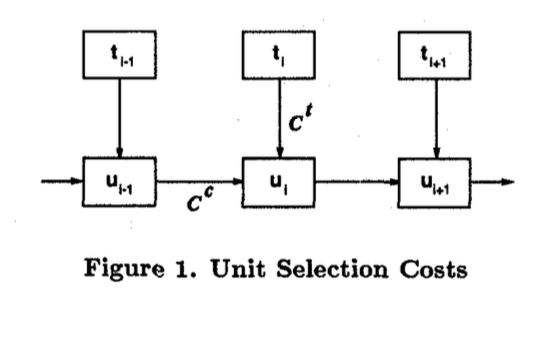

# Concatenative Text-To-Speech

_Notes to self_

I don't know what style to write these in. I want to be able to share this on my blog and socials, for a technical audience but appreciable by laymen as well. Formal, but using I and we.

Already I am seeing that more examples are needed!

- Target and candidate sequence illustrations!

To understand modern text to speech systems, I thought it would be useful to start at the beginning. Before deep learning approaches used today, problems like text-to-speech (tts) were solved algorithmically. This meant applying complex rule-based and statistical algorithms on input data to produce the desired results. Contrast this approach to deep learning, where rules are learned by processing vast amounts of data. While these early algorithms are in my opinion somewhat more complicated, they are not without their merits. Implementing algorithms in this manner requires a deep understanding of the domain and the data. Something I hoped to gain as I set out to implement one of the first sota tts implementations - speech synthesis via concatenation of phonemes.

## Reference Paper(s) and Dataset

My implementation was based on this paper _Speech Synthesis by Rule Using an Optimal Selection of Non-Uniform Synthesis Units_, and I used the corresponding CMU Arctic dataset. The dataset contains audio files of speech, and label files that identify and locate phonemes within the speech.

### Algorithm

Synthesis of output waveforms is done by concatenating phonemes from the database. Given a sequence of target phonemes, we search for an optimal sequence of phonemes from the database from which to compose our speech. Corresponding phoneme audio data is then concatenated to the output sequence (more advanced concatenation techniques maybe used e.g./tdpsola).

The database in this algorithm is treated as a state transition network. Given the target sequence, we want to select units such that we minimize some cost function for the sequence as a whole. Two costs are used: target and concatenative cost, which will be discussed in more detail later.

## Data

The extracted data contained ~1000 .wav files of labelled speech. Speech was labelled with composite phonemes and their locations in the file. Pitch mark files were also available for extracting fundamental frequency of the phonemes.

## Features and Cost Functions

For this application (and most if not all) raw data must be massaged into compute friendly features. Features are required for the target and concatenation cost functions, the training of their weights, and synthesis.

### Target Cost Function and Features

The target cost function describes the difference between the target unit and the candidate unit. Features for calculation of the target cost include phonetic identity of the current, preceding, and following phonemes (e.g./ vowel or consonant, consonant type, voicing, manner, placement). As these are all discrete features, they receive a binary score. Each of the $p$ sub-cost functions has a unique weight.

$$ C^{t}(t_i, u_i) = \sum_{j=1}^{p} w_j C^{t}_{j}(t_i, u_i) $$

### Concatenation Cost Function and Features

The concatenation cost function describes the cost of joining two units. The concatenation cost uses acoustic features of the phonemes (e.g./ cepstral distance at the concatenation point, differences in log power and log pitch).

### Final Cost Function

$$ C(t_1^n, u_1^n) = \sum_{i=1}^{n} \sum_{j=1}^{p} w_j^tC_j^t(t_i, u_i^t) + \sum_{i=2}^{n} \sum_{j=1}^{q} w_j^cC_j^c(u_j, u_i) + C^s(S, u_1) + C^c(u_n, S) $$

Where $S$ is silence.

## Training

Training the weights for synthesis is done via multiple linear regression. Data held back from the unit synthesis database is used as target phoneme sequences to train against. For each phoneme in the target sequence, we find its $N$ best acoustic matches via MFCC distance. We then compute the target subcosts between the target phoneme and its $N$ best matches. Finally, we use a multiple linear regression to predict the objective distance by weighting the calculated sub-costs.

### Training Implementation

I'd never implemented multiple linear regression before, and I was batching this one to boot. Here's how I went about implementing it.

As we're processing phonemes in batches ($TargetSequenceLength \times N \times p$ is large) we accumulate sufficient statistics (I know nothing about sufficient statistics) for the regression as we iterate through sequences and their constituting phonemes.

$$\mathbf{A} = \sum_{\text{batch}} \mathbf{X}_{\text{batch}}^T \mathbf{X}_{\text{batch}} \quad \text{and} \quad \mathbf{b} = \sum_{\text{batch}} \mathbf{X}_{\text{batch}}^T \mathbf{Y}_{\text{batch}}$$

After the entire training set has been accumulated, the weight vector is then calculated.

$$\mathbf{w}^t = \mathbf{A}^{-1} \mathbf{b}$$

### Limitations in Training (and Synthesis)

As initially alluded to in the intro of this piece, classical algorithmic approaches require rich pre-processing of input data. During training this rich data is available to us as we have both the labelled and acoustic speech data. During synthesis however, we have only label data. 

Modelling acoustic data from raw string data is complex and vastly outside the scope of this project for myself. We solely possess text from which to guess at the best matching units in the database. Needless to say that later our results - while correct - were not perceptually impressive.

## Synthesis

For synthesis I used a plain concatenative system. The best phonemes were determined via search, then spliced together from their source audio. Better results could be achieved with a TDPSOLA vocoder I believe. Synthesis suffered from the aforementioned synthesis limitation - no acoustic nor prosodic information for the target sequence.

## Results

My main takeaway from this is that classical methods require a rich frontend for text processing. It was fun to try some hands-on data science though: downloading and processing raw data, pulling out useful features for training.

It will be interesting applying deep learning methods to this problem in the future. 

Relevant applications I could think of were:
- Learning an embedding space for characters based on their pre/proceeding characters
- Learning waveform synthesis from some learned feature representation

Given the vast amount of data available for this problem, deep learning seems 
especially applicable here.
